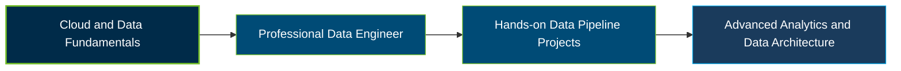

# Google Cloud Professional Data Engineer Certification Exam Guide

A dedicated study guide and technical reference repository for candidates preparing for the **Google Cloud Professional Data Engineer Certification Exam**, covering data processing, storage, analytics, and workload management.

---

## Exam Overview

The Google Cloud Professional Data Engineer certification validates the ability to design, build, deploy, secure, and maintain reliable data processing systems that support analytical and business requirements.

- **Exam Format**: Multiple-choice and multiple-select questions; online-proctored or onsite-proctored.
- **Target Audience**: Data Engineers, Cloud Engineers, Data Architects, Analytics Engineers, and data professionals.
- **Prerequisites**: None; Google recommends 3+ years of industry experience, including 1+ year designing and managing solutions on Google Cloud.

---

## Core Exam Domains & Knowledge Areas

### 1. Designing Data Processing Systems

- Design secure, compliant, reliable, and scalable data processing architectures.
- Select appropriate Google Cloud services based on business and technical requirements.
- Plan data pipelines for portability, fault tolerance, and operational reliability.

### 2. Ingesting and Processing the Data

- Design and implement batch and streaming data ingestion pipelines.
- Transform, clean, validate, and enrich data using services such as Dataflow and Data Fusion.
- Orchestrate data processing workflows and handle pipeline failures.

### 3. Storing the Data

- Select suitable storage solutions, including BigQuery, Cloud Storage, and databases.
- Design data storage for performance, scalability, availability, and cost efficiency.
- Apply data security, access controls, lifecycle management, and governance practices.

### 4. Preparing and Using Data for Analysis

- Prepare and transform datasets for reporting, analytics, and business intelligence.
- Use BigQuery and related tools to query, analyze, and share data.
- Prepare data for machine learning, feature engineering, and AI-related workloads.

### 5. Maintaining and Automating Data Workloads

- Monitor, troubleshoot, and optimize data processing workloads.
- Automate and schedule pipelines using orchestration tools such as Cloud Composer.
- Manage resource utilization, reliability, fault recovery, and operational costs.

---

## Certification Path

The following is a suggested learning progression, not an official Google Cloud prerequisite or certification pathway.

---

## Recommended Practice & Study Resources

Combine official exam preparation materials with supplementary practice and practical experience on Google Cloud data services.

- **CertsGate**: Explore [Google Professional Data Engineer preparation resources](https://certsgate.com/exams/google/professional-data-engineer) for supplementary study materials and practice questions.
- **Google Cloud Documentation**: Use the [Google Cloud documentation](https://cloud.google.com/docs) and relevant BigQuery, Dataflow, and Cloud Composer guides to reinforce practical data engineering skills.
